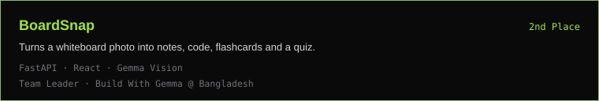

Backend and AI Engineer, 2x hackathon winner. CSE student at Daffodil International University, Dhaka.

## Featured Projects

## Stack

Also: DRF · Celery · LLM Integration · Gemma Vision · LangChain · LangGraph · RAG · Prompt Engineering
